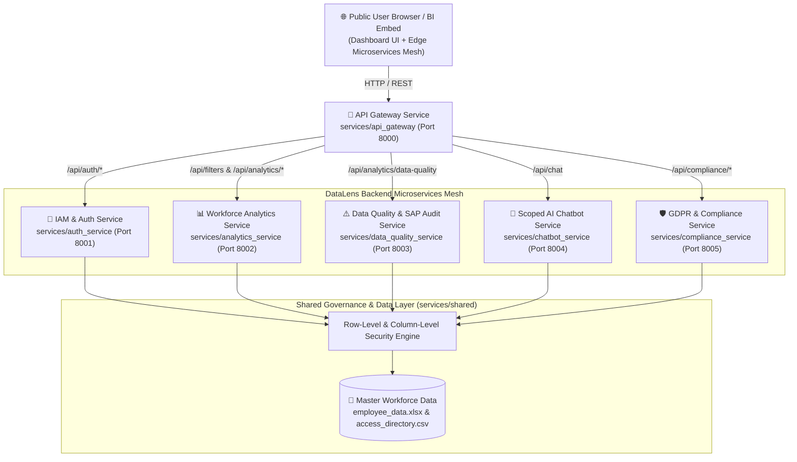

# 🌐 DataLens Enterprise — Global Manager (Microservices Architecture)

[](https://drkanurag.github.io/DataLens-Global-Manager/)
[](https://drkanurag.github.io/DataLens-Global-Manager/frontend/)
[](https://raw.githack.com/drkanurag/DataLens-Global-Manager/main/index.html)

---

## 🔗 Clickable Public Links (Open & Use Immediately)

Anyone in the public can click the links below to open and use **DataLens Enterprise** directly in their browser (no installation required):

- 🚀 **Primary Live Public Application (GitHub Pages):** [**https://drkanurag.github.io/DataLens-Global-Manager/**](https://drkanurag.github.io/DataLens-Global-Manager/)
- 🌐 **Direct Public Dashboard Endpoint:** [**https://drkanurag.github.io/DataLens-Global-Manager/frontend/**](https://drkanurag.github.io/DataLens-Global-Manager/frontend/)
- ⚡ **Instant Public CDN Mirror (Raw GitHack):** [**https://raw.githack.com/drkanurag/DataLens-Global-Manager/main/index.html**](https://raw.githack.com/drkanurag/DataLens-Global-Manager/main/index.html)
- 💻 **Local Microservices API Gateway (when running locally):** [**http://localhost:8000/dashboard/**](http://localhost:8000/dashboard/)

---

## 🔑 Authorized Role IDs for Login

When you open the application, sign in using any of the governed **Role IDs** below:

| Role ID | Alias | Stakeholder Role | Authorized Location Scope | Compensation & Executive Access |
| :--- | :--- | :--- | :--- | :--- |
| **`GDF`** | `GDF001` | **Global Data Foundation** | 🌐 **All Locations (Global)** | Full Enterprise Compensation & Executive Summary Suite |
| **`HRBP-KOL`** | `HRBP_KOL` | **HRBP – Kolkata (MOM / P&O)** | 🔒 **Kolkata Only** | Kolkata Site Compensation & Quality Remediation |
| **`HRBP-MUM`** | `HRBP_MUM` | **HRBP – Mumbai** | 🔒 **Mumbai Only** | Mumbai Site Compensation & Quality Remediation |
| **`HRBP-DEL`** | `HRBP_DEL` | **HRBP – New Delhi** | 🔒 **New Delhi Only** | New Delhi Site Compensation & Quality Remediation |
| **`HRBP-BLR`** | `HRBP_BLR` | **HRBP – Bengaluru** | 🔒 **Bengaluru Only** | Bengaluru Site Compensation & Quality Remediation |
| **`HRBP-HYD`** | `HRBP_HYD` | **HRBP – Hyderabad** | 🔒 **Hyderabad Only** | Hyderabad Site Compensation & Quality Remediation |
| **`HRBP-CHN`** | `HRBP_CHN` | **HRBP – Chennai** | 🔒 **Chennai Only** | Chennai Site Compensation & Quality Remediation |
| **`HRBP-PUN`** | `HRBP_PUN` | **HRBP – Pune** | 🔒 **Pune Only** | Pune Site Compensation & Quality Remediation |
| **`HRBP-GUR`** | `HRBP_GUR` | **HRBP – Gurugram** | 🔒 **Gurugram Only** | Gurugram Site Compensation & Quality Remediation |

---

## 🏗️ Microservices Architecture

DataLens Enterprise is built as a **6-Service Microservices Mesh** with a shared Row-Level Security (RLS) and Column-Level Security (CLS) governance core, plus a **Client-Side Edge Microservices Runtime** (`frontend/microservices-mesh.js`) so the public web app works seamlessly both with the Python FastAPI cluster and on static public cloud hosting.



### Microservices Directory & Port Mapping

| Microservice | Directory | Port | Key Endpoints | Responsibility |
| :--- | :--- | :--- | :--- | :--- |
| **1. API Gateway Service** | `services/api_gateway/` | `8000` | `/dashboard/`, `/api/health`, `/api/services/status` | Reverse proxy routing, service mesh health discovery, and static UI hosting |
| **2. IAM & Auth Service** | `services/auth_service/` | `8001` | `POST /api/auth/login`, `GET /api/auth/me`, `GET /api/auth/validate` | Role-based authentication, alias resolution, HMAC token issuance, and session validation |
| **3. Workforce Analytics Service** | `services/analytics_service/` | `8002` | `GET /api/filters`, `GET /api/analytics/summary`, `/by-location`, `/by-department`, `/by-job-family`, `/monthly`, `/employees`, `/executive-summary` | RLS-filtered KPIs, organizational span of control, executive briefings, and CLS salary masking |
| **4. Data Quality & SAP Audit Service** | `services/data_quality_service/` | `8003` | `GET /api/analytics/data-quality`, `GET /api/data-quality/rules` | Automated EC vs. SAP reconciliation across 7 anomaly categories, missing fields, and duplicate detection |
| **5. Scoped AI Chatbot Service** | `services/chatbot_service/` | `8004` | `POST /api/chat`, `GET /api/chat/health` | Natural language workforce assistant, cross-location RLS query blocking, and SOP remediation guidance |
| **6. GDPR & Compliance Service** | `services/compliance_service/` | `8005` | `GET /api/compliance/audit-log`, `/gdpr-status`, `/stakeholders`, `POST /api/compliance/log-export` | Immutable security event stream, GDPR Art. 5/15/25/32/33 compliance status, and SAR export auditing |

---

## 🚀 How to Run the Microservices

### Option 1: Launch All 6 Microservices Locally (Python Orchestrator)

Use Python 3.11+ to install requirements and start all 6 microservices concurrently on ports `8000`–`8005`:

```powershell
python -m pip install -r backend/requirements.txt
python start_microservices.py
```

Or using PowerShell:

```powershell
.\start_microservices.ps1
```

- **Dashboard UI:** [http://localhost:8000/dashboard/](http://localhost:8000/dashboard/)
- **Live Microservices Mesh Status:** [http://localhost:8000/api/services/status](http://localhost:8000/api/services/status)

### Option 2: Run with Docker Compose (Containerized Microservices)

```powershell
docker-compose up --build
```

This builds and starts `datalens-api-gateway` (`:8000`), `datalens-auth-service` (`:8001`), `datalens-analytics-service` (`:8002`), `datalens-data-quality-service` (`:8003`), `datalens-chatbot-service` (`:8004`), and `datalens-compliance-service` (`:8005`) on the `datalens-mesh` bridge network.

### Option 3: Run Unified Gateway Mode (Single Process)

```powershell
cd backend
uvicorn main:app --reload
```

Then open [http://localhost:8000/dashboard/](http://localhost:8000/dashboard/).

---

## 📊 Power BI & Tableau Integration

### Power BI Integration
Use the same governed `employee_id → location` mapping as a security table in the Power BI semantic model. Create a relationship from `Access[location]` to the employee-data location, then create a role with this DAX filter on the access table:

```DAX
Access[UPN] = USERPRINCIPALNAME()
```

Assign users/groups to the role in the Power BI Service and test with **View as**. This applies native Power BI Row-Level Security (RLS), including when users use filters, export data, or interact with visuals.

### Tableau Integration
Create a user-location entitlement table with `username` and `location`, join/relate it to the employee data by location, and add a data-source filter:

```tableau
[Username] = USERNAME()
```

Publish the data source and workbook, then validate with **Preview as User**.

---

## ⚠️ Configured Master-Data Quality Rules (EC vs. SAP)

The `data-quality-service` (`:8003`) continuously audits 7 master-data reconciliation rules within the user's authorized location scope:
1. **Salary not matching with SAP** (`SOP-HR-01` — Critical)
2. **Cost centre mismatch with company code** (`SOP-HR-02` — High)
3. **High range penetration percentage** (`SOP-HR-05` — Advisory)
4. **Department Code is not matching EC vs SAP** (`SOP-HR-03` — Medium)
5. **Incorrect Business Email** (`SOP-HR-04` — High)
6. **Manager is not matching EC vs SAP** (`SOP-HR-06` — Medium)
7. **Company Code is not matching EC vs SAP** (`SOP-HR-07` — High)
